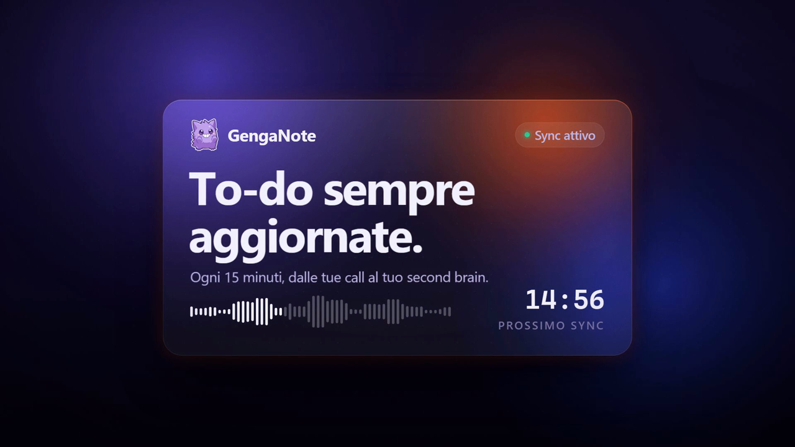
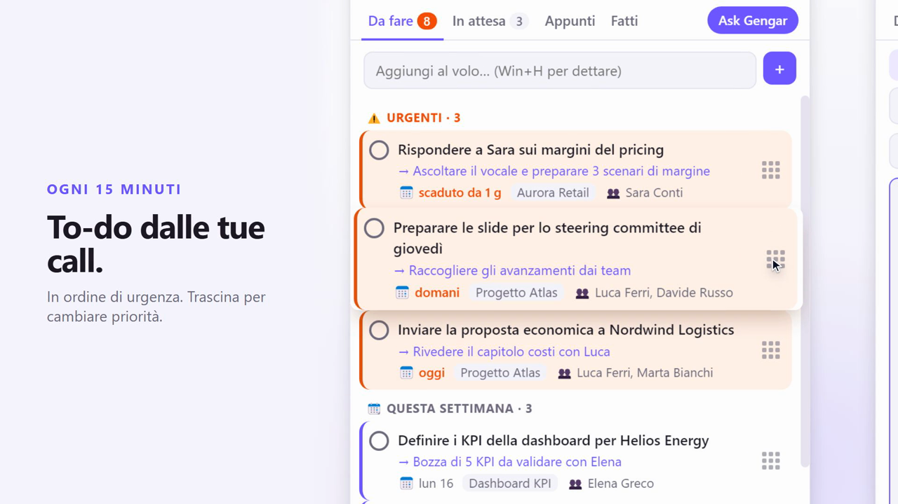
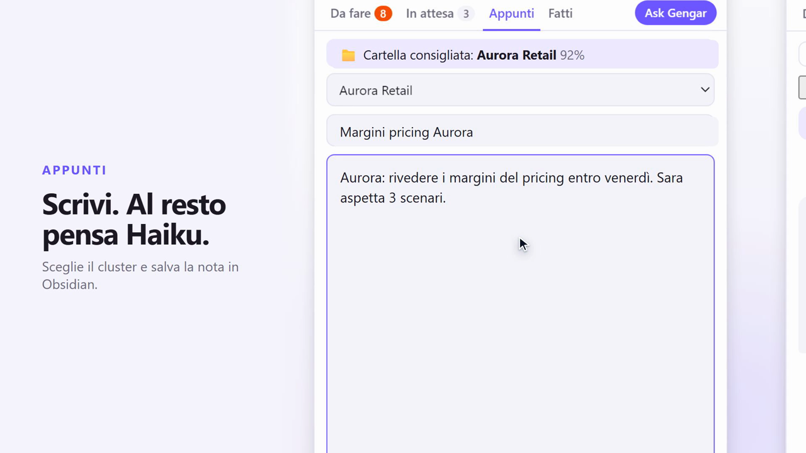
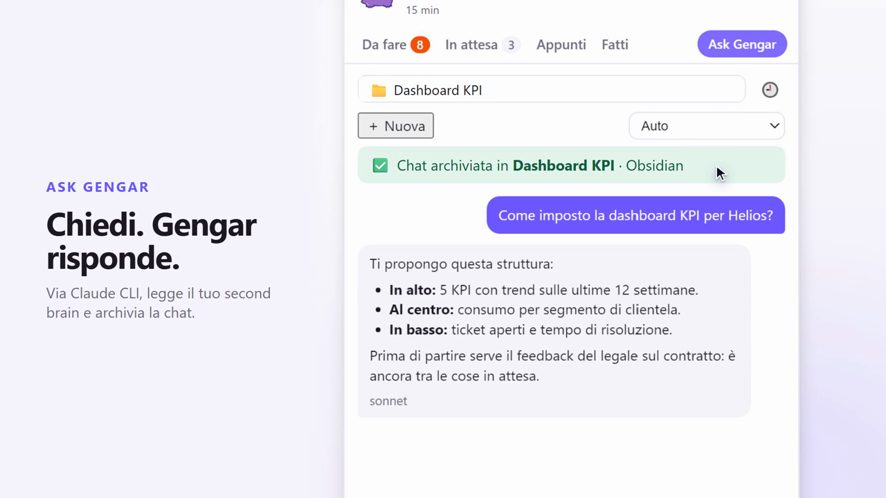
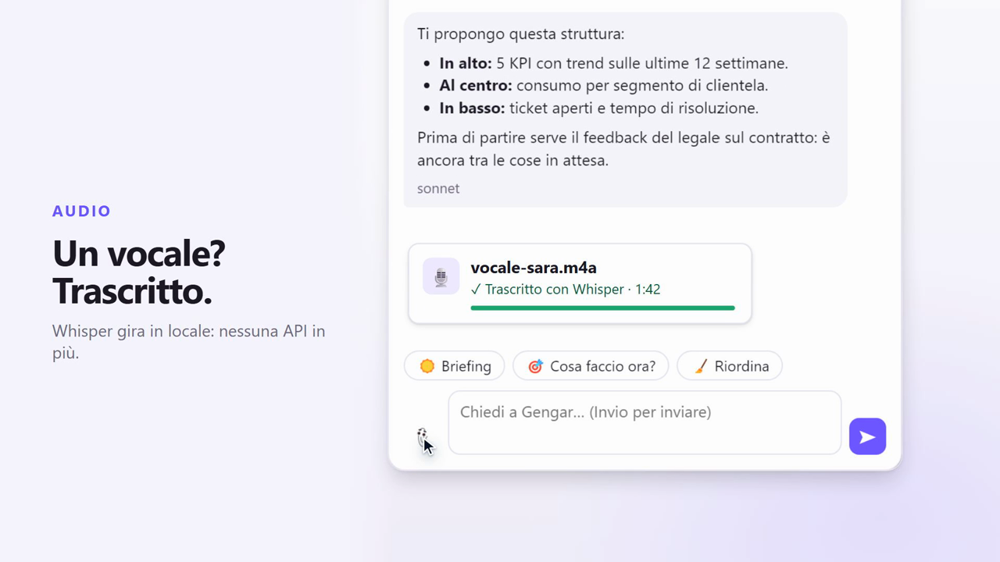
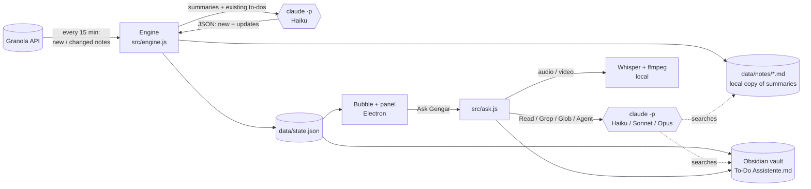

<div align="center">

# 👻 GengaNote

**Your meetings write your to-do list.**

[](docs/demo.mp4)

🎬 **[Watch the 35-second demo](docs/demo.mp4)**


</div>

A little ghost mascot floats on top of your Windows desktop, reads your [Granola](https://granola.ai) meeting notes every 15 minutes, uses the [Claude Code CLI](https://docs.anthropic.com/en/docs/claude-code) to pull out what *you* promised to do, sorts it by urgency, and files everything into your Obsidian second brain. **No extra API bills**: Claude runs on your existing Claude login, and audio is transcribed on your own PC.

| To-dos from your calls | Notes, auto-filed by Haiku |
|---|---|
|  |  |
| **Ask Gengar: chat via Claude Code** | **Voice notes, transcribed locally** |
|  |  |

<sub>All data in the screenshots and in the demo comes from the built-in **Mock mode**: fictional companies and people.</sub>

> ℹ️ The user interface and the prompts sent to Claude are in **Italian**. Tabs: *Da fare* (To do), *In attesa* (Waiting), *Appunti* (Notes), *Fatti* (Done), *Ask Gengar*.

---

## ✨ Features

- **Always-on-top mascot bubble** – a draggable ghost that stays above every window. Its badge shows how many to-dos are open and turns **red** when something is urgent (due today/tomorrow or overdue by at most 2 days).
- **Automatic to-dos from your meetings** – every 15 minutes new or changed Granola notes are sent to Claude (Haiku by default), which extracts action items with title, context, next step, project, people, due date and priority. Existing to-dos are de-duplicated and updated (new due date, next step, or marked done) instead of duplicated.
- **Waiting-for tracking** – things you are waiting on from other people land in *In attesa* with who you are waiting on.
- **Smart ordering** – urgent items first, then "this week", then the rest, plus a *"⌛ Scaduti — ancora da fare?"* (overdue — still relevant?) bucket. Grab the 9-dot handle to **drag and reorder**; your manual order is remembered.
- **Quick add** – type (or dictate with `Win+H`) a sentence; Claude turns it into a structured to-do with due date, project and next step.
- **Notes → Obsidian** – write a note in *Appunti*; an agent suggests the right folder (with a confidence score) and a title, then saves it as Markdown into `<vault>/Appunti/<folder>/`. Drafts survive closing the panel.
- **Ask Gengar chat** – one chat that knows your to-dos, your Granola notes and your vault:
  - can **add / edit / complete to-dos** for you;
  - delegates searches to a fast `ricercatore` (researcher) sub-agent, in parallel if needed;
  - **Auto** model routing: a Haiku triage step picks Haiku, Sonnet or Opus based on difficulty (or choose manually);
  - quick buttons: ☀️ daily briefing, 🎯 "what should I do now?", 🧹 re-prioritize;
  - **history** of chats with **📌 pinning**;
  - **clusters**: file a chat into a project folder of your vault; for unfiled chats Gengar **suggests a cluster** after the first answer (✅ accept / ❌ dismiss);
  - **attachments** (📎): images, PDFs and text are read by Claude; **audio and video are transcribed locally with Whisper** – no paid transcription API;
  - every exchange is logged to a daily note `<vault>/Ask Gengar/YYYY-MM-DD.md` (off-topic messages are tagged `#non-rilevante`).
- **Read-only to-do mirror in Obsidian** – `<vault>/To-Do Assistente.md` is regenerated on every change.
- **Mock / Official switch** – show a fully fictional dataset (companies, people, chats, notes) for screenshots and demos without touching your real data.
- **Hide in the corner** – `Ctrl+Alt+G` tucks the ghost into the bottom-right corner, peeking over the taskbar.
- **Starts with Windows** (toggle from the right-click menu).

## 🧠 How it works



1. **Sync loop** (`src/engine.js`): 5 s after launch and then every `syncMinutes`, GengaNote lists Granola notes created in the last `firstSyncDaysBack` days (first run) or 3 days (afterwards). Notes whose summary changed are copied to `data/notes/` and sent to Claude in batches of 4 together with your current to-do list. Claude answers with JSON (`new` and `updates`) which is merged into `data/state.json`.
2. **Claude** is invoked through the Claude Code CLI (`claude -p --output-format json`, no MCP servers, no user settings, no session persistence). It uses your Claude subscription / login – **no Anthropic API key is needed**.
3. **UI** (`src/main.js`, `src/renderer/`): a transparent always-on-top bubble window and a panel window talk to the engine over IPC.
4. **Obsidian**: the vault is optional. Without it you still get to-dos and chat, but no mirror file, no saved notes and no chat archive.

## 📋 Requirements

| Requirement | Notes |
|---|---|
| **Windows 10/11** | Built and tested on Windows (autostart, taskbar "peek", `taskkill`). Other OSes are untested. |
| **Node.js 18+** (20+ recommended) on your `PATH` | Also used to run the local Whisper transcription in a separate process. |
| **Claude Code CLI**, logged in | `npm install -g @anthropic-ai/claude-code`, then run `claude` once and log in. The `claude` command must be on your `PATH` (or set `claudeCmd`). Model access to Haiku / Sonnet / Opus is required. |
| **Granola account + API key** | Needed for the meeting sync. Everything else works without it. |
| **Obsidian vault** _(optional)_ | Auto-detected from Obsidian's own settings, or set `vaultPath`. |

## 🚀 Install & run

```bash
git clone https://github.com/GioCorna97/genganote.git
cd genganote
npm install
copy config.example.json config.json   # then edit it (see below) – optional
npm start
```

- `npm start` – launches the widget detached from the terminal (works from VS Code's terminal too).
- `npm run sync` – runs a one-off sync in the terminal and prints progress / errors (handy for debugging).
- `npm run dev` – runs `electron .` directly (fails if `ELECTRON_RUN_AS_NODE` is set, see Troubleshooting).

**Using it**

- **Click** the ghost → open/close the panel. **`Alt+G`** does the same from anywhere.
- **`Ctrl+Alt+G`** → hide the ghost in the bottom-right corner; click it (or press either hotkey) to bring it back.
- **Drag** the ghost to move it. **Right-click** → sync now, hide, Mock mode, open data folder, open the to-do file in the vault, start with Windows, reset position, quit.
- `Esc` closes the panel; `Ctrl+Enter` saves a note; `Enter` sends a chat message (`Shift+Enter` for a new line).

## ⚙️ Configuration

All settings are optional. Create `config.json` in the project root (it is git-ignored) – start from [`config.example.json`](config.example.json) and **delete the keys you don't need**, especially the placeholder `granolaApiKey` / `vaultPath`, otherwise the placeholders override auto-detection.

| Key | Default | Meaning |
|---|---|---|
| `granolaApiKey` | auto | Granola API key. Lookup order: `config.json` → `GRANOLA_API_KEY` env var → the key saved by the Obsidian plugin `granola-sync` in `<vault>/.obsidian/plugins/granola-sync/data.json`. |
| `vaultPath` | auto | Path of your Obsidian vault. Auto-detected from `%APPDATA%\obsidian\obsidian.json` (the open vault, or the most recently used one). |
| `userName` | `"User"` | Your name, used in the prompts ("actions assigned to *&lt;name&gt;*"). Set it so Claude can tell your actions from other people's. |
| `syncMinutes` | `15` | Minutes between Granola syncs. |
| `firstSyncDaysBack` | `7` | How many days of meetings the very first sync reads. |
| `model` | `"claude-haiku-5-5"` | Model for fast tasks: action extraction, quick-add enrichment, note folder suggestion. |
| `subagentModel` | `"haiku"` | Model of the `ricercatore` research sub-agent used by Ask Gengar. |
| `chatModel` | `"claude-opus-5-5"` | Reserved. Currently **not used**: Ask Gengar chooses between `claude-haiku-5-5`, `claude-sonnet-5-5` and `claude-opus-5-5` (defined in `src/ask.js`) via the *Auto* / manual selector. |
| `claudeCmd` | `"claude"` | Command used to launch the Claude Code CLI. |
| `vaultTodoFile` | `"To-Do Assistente.md"` | Read-only to-do mirror written inside the vault. Set to `null` to disable. |
| `notesFolder` | `"Appunti"` | Vault folder for saved notes and filed chats (`<vault>/<notesFolder>/<folder>/`). |
| `askFolder` | `"Ask Gengar"` | Vault folder for the daily Ask Gengar log. |
| `autoStart` | `true` | Register "start with Windows" on first launch. Afterwards the right-click menu toggle wins. |
| `hotkey` | `"Alt+G"` | Global shortcut to open/close the panel (falls back to `Alt+G`, then `Ctrl+Alt+B` if taken). |
| `hideHotkey` | `"Control+Alt+G"` | Global shortcut to hide/show the ghost in the corner (falls back to `Ctrl+Alt+H`). |

Whisper transcription uses the `Xenova/whisper-small` model with Italian as the default language (`src/transcribe.js`).

## 🎭 Mock mode (for screenshots & demos)

Flip the **Mock / Official** switch in the panel header (or right-click → *Modalità Mock*). Every tab then shows a synthetic dataset from `src/mock.js` – fictional companies, people, meetings, notes and chats – stored in `data-mock/` and regenerated once a day so that due dates stay relative to today. In Mock mode no Granola calls are made (sync is simulated) and your real data is never read or written. The app always starts in **Official** mode.

## 🔒 Privacy

- **Everything is stored locally**: to-dos, chats, UI state and attachments live in `data/` inside the project folder; notes and chat archives go to your own Obsidian vault. There is no server and no telemetry.
- **Sent to Granola**: only authenticated, read-only requests to the Granola public API (list notes, get a note, list folders) with your API key.
- **Sent to Claude** (through the Claude Code CLI, i.e. to Anthropic under your Claude account): meeting summaries and your private Granola notes, your current to-do list, text you add or ask about, note text for folder suggestions, chat history (last 10 messages), attachments that Claude reads (images, PDFs, text), Whisper transcripts, and any file contents the agent reads while searching `data/notes/` and your vault.
- **Whisper runs locally**: audio/video is converted with a bundled `ffmpeg` and transcribed on your machine with `@huggingface/transformers`. The model (several hundred MB) is downloaded once from Hugging Face into `data/models/`; the audio itself never leaves your PC.
- `config.json` and `data/` are git-ignored – keep it that way.

## 🛠️ Troubleshooting

| Problem | Fix |
|---|---|
| `electron .` crashes or behaves like plain Node | `ELECTRON_RUN_AS_NODE` is set (VS Code's integrated terminal does this). Use `npm start`, which clears it, or unset the variable before `npm run dev`. |
| Banner "API key Granola non trovata" | Add `granolaApiKey` to `config.json`, set `GRANOLA_API_KEY`, or install the `granola-sync` Obsidian plugin in your vault. |
| "Claude non ha risposto in tempo" / invalid output | Make sure `claude -p "hello"` works in a terminal and that you are logged in. Set `claudeCmd` if the CLI is not on `PATH`. Run `npm run sync` to see errors. |
| Doesn't start with Windows | Toggle *Avvia con Windows* in the right-click menu. The entry points at this folder's Electron binary, so re-toggle it after moving the project. Paths with spaces are quoted on purpose. |
| Ghost disappears / looks broken after moving between monitors with different scaling (mixed DPI) | GengaNote reloads the bubble when the display scale changes and re-heals it after sleep/unlock/display changes. If it still looks off, right-click → *Riposiziona bolla*. Hardware acceleration is disabled on purpose to keep transparent windows stable. |
| Audio transcription fails | `node` must be on `PATH`; the first run needs internet to download the Whisper model. |
| Hotkey doesn't work | Another app owns it; GengaNote tries the fallbacks listed above. Pick another key in `config.json`. |

## 📁 Project structure

```
genganote/
├─ scripts/start.js        # launcher: clears ELECTRON_RUN_AS_NODE, starts Electron detached
├─ src/
│  ├─ main.js              # Electron main process: bubble + panel windows, right-click menu, hotkeys, IPC, autostart, Mock/Official
│  ├─ config.js            # settings: defaults + config.json + auto-detection (vault, Granola key)
│  ├─ engine.js            # to-do state, Granola sync, Claude extraction, notes → vault, vault mirror
│  ├─ ask.js               # Ask Gengar chat: model routing, sub-agent, to-do actions, clusters, attachments
│  ├─ claude.js            # thin wrapper around `claude -p`
│  ├─ granola.js           # minimal Granola public API client
│  ├─ transcribe.js        # local Whisper transcription (ffmpeg + @huggingface/transformers)
│  ├─ mock.js              # fictional dataset for Mock mode
│  ├─ cli-sync.js          # `npm run sync`
│  ├─ preload.js           # safe IPC bridge for the renderer
│  └─ renderer/            # bubble.html, panel.html/.css/.js, ask-ui.js, assets/
├─ config.example.json
└─ data/                   # created at runtime, git-ignored
```

## 🤝 Contributing

Issues and pull requests are welcome!

- Keep it dependency-light and local-first; never commit `config.json`, `data/` or real meeting content.
- Use **Mock mode** for any screenshot you attach to an issue or PR.
- Test with `npm start` (UI) and `npm run sync` (sync loop) before opening a PR.
- English translations of the UI/prompts would be a great first contribution.

## 🇮🇹 In breve

GengaNote è una bolla sempre in primo piano che trasforma le note delle call Granola in una to-do list ordinata per urgenza (tramite Claude Code CLI), con chat *Ask Gengar*, appunti salvati su Obsidian e trascrizione locale di audio e video con Whisper. Installazione: `npm install`, poi `npm start`.

## 📄 License

Code released under the [MIT License](LICENSE).

**Artwork & trademarks:** GengaNote is an unofficial fan project and is not affiliated with or endorsed by Nintendo, Creatures Inc., GAME FREAK or The Pokémon Company. Gengar is a trademark of its respective owners. The mascot images in `src/renderer/assets/` are **not** covered by the MIT license; replace them with your own artwork if you redistribute the app.
